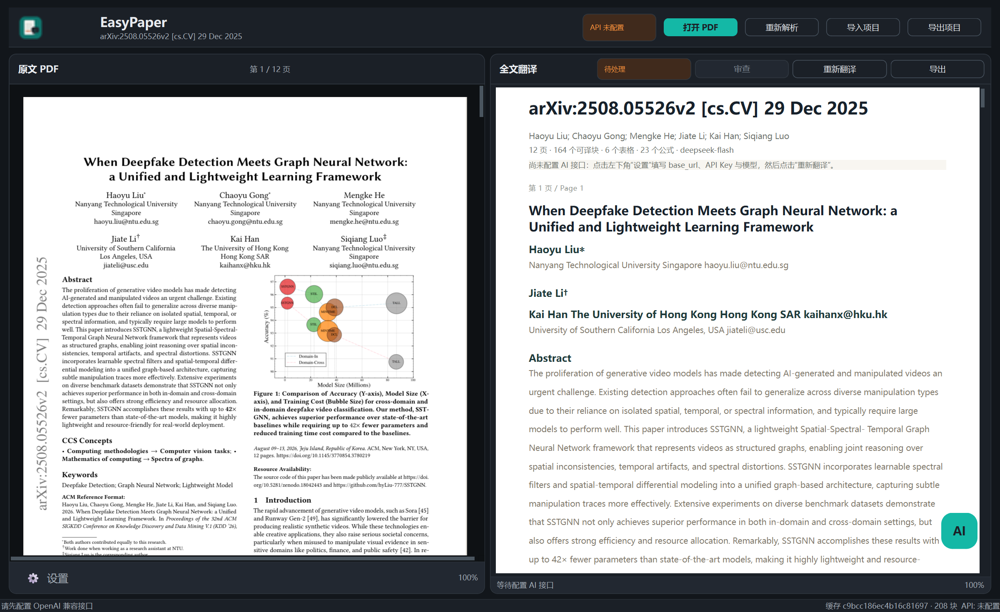

# EasyPaper

本地优先的论文阅读 / 全文翻译 / AI 问答桌面工具。PDF、OCR 与缓存留在本机，翻译和问答只发送必要文本。

> 界面示意：本地 mock OpenAI 服务 + 示例论文；实际模型与界面完全一致。

- **三栏界面**：左侧 PDF 原文，中间结构化全文译文，右侧基于全文的 AI 问答。
- **独立缩放/横移**：在任意一栏按 `Ctrl + 滚轮` 缩放，`Shift + 滚轮` 横向滚动；`Ctrl + 0` 重置。
## v2 重构说明

- **Python 3.12 + uv**：`.venv` 固定 Python 3.12，避免 3.14 与 OXR/torch/transformers 的依赖冲突；安装使用镜像源。
- **OXR 接入层**：`app/ocr/base.py` 定义与厂商无关的 `OcrEngine`；`app/ocr/oxr_engine.py` 是 OXR 适配器；PDF/UI 只调用 `OcrService`。以后替换 OCR 模型只改适配器。
- **AI 问答悬浮球**：右侧固定聊天栏已删除；右下角圆角方形 `AI` 球可全窗口拖动，拖到右侧边缘会吸附成圆角卡片；点击平滑展开问答面板，面板可用左上角 `⋮⋮` 拖动，左上角 `‹` 收回。
- **版式保持**：单栏论文按单栏渲染；双栏论文按左右栏渲染译文，表格/图片/公式仍按原阅读顺序嵌入。
- **相机式缩放**：译文排版宽度固定，Ctrl+滚轮通过 CSS transform 缩放/移动视口，不再重排字体和图片。
- **公式/图表**：独立公式保留原始区域图片；行内短公式由 OXR 输出 LaTeX 后用 KaTeX 渲染；图表和表格继续嵌入原图。
- **OCR 设备**：默认 CUDA；可在设置中切换 CPU。
- **AI 默认配置**：`https://api.deepseek.com` / `deepseek-flash`。

- **本地预处理**：PyMuPDF 解析版式，本地 **OXR-1.0** 处理扫描页，生成结构化 JSON 缓存；数字版论文直接使用内嵌文字层。
- **结构化翻译**：保留标题、章节、段落、表格、公式、图注和阅读顺序，按块调用任意 OpenAI 兼容 API。
- **统一单栏阅读**：中间译文固定为单栏纵向流，按页和阅读顺序组织；双栏原文只在解析阶段按栏排序，不再把译文拆成窄列。
- **图片真实嵌入**：从 PDF 页面裁剪并缓存图像区域，在译文中以图片形式展示。
- **表格/公式直接嵌图**：表格和独立公式按 PDF 页面区域裁剪为 PNG 后嵌入译文，不再重建行列或转 LaTeX，彻底避开解析错误；提取出的文本仍保留给问答和导出。
- **结构化 HTML 渲染**：中间栏使用本地 QtWebEngine 页面；正文是结构化 HTML，行内公式由 KaTeX 渲染，版面/回退表格用 CSS Grid；不依赖远程 CDN。
- **首次翻译前清理页眉页脚**：在切分翻译批次之前，本地识别页面边缘的重复文本、页码、running title、arXiv/版权/下载水印，并直接标记隐藏；OCR 页在合并后二次清理。
- **项目包导入 / 导出**：顶部“导入项目 / 导出项目”导出原文 PDF、结构、译文、表格/公式/图片资产和 AI 问答记录；导入后自动打开原文、译文和聊天记录，不调用 LLM。
- **深色模式与主题色**：支持跟随系统 / 浅色 / 深色，以及青绿、蓝、红、紫、琥珀五种强调色，设置内切换后立即生效。
- **思考强度 / 费用控制**：翻译与 AI 对话可分别设置思考强度（自动 / 关闭 / 最低 / 低 / 中 / 高），默认“自动”只对识别到的推理模型发送 `reasoning_effort`，普通模型不发送，兼顾兼容性和费用。
- **翻译后审查**：翻译完整结束后可调用 AI 终审，只清理页眉、页脚、页码、running title 等页面级冗余信息。
- **缩放保持阅读位置**：中间栏缩放后通过块级锚点回到原来的阅读位置，不再因为字号变化跳到别处。
- **原文选中提问**：在左侧拖动选中英文原文，点击“引用提问”或“立即提问”。
- **不卡界面**：PDF 渲染、OCR、翻译、问答全部在 GUI 线程之外执行。
- **不引入 Electron/Node、无数据库**：Python 3.12 + PySide6 + PyMuPDF + OpenAI 兼容接口 + PyInstaller；中间栏使用 QtWebEngine 在进程内渲染本地 HTML/KaTeX/CSS Grid。
- **便携数据**：配置、缓存、日志、OCR 模型和运行时缓存全部位于项目目录，不写用户目录。



---

## 1. 当前环境与目录

```text
F:\EXP\easypaper\
├─ EasyPaper.exe                 # 构建产物（GUI 启动器，约 14 MB）
├─ _internal\                    # PyInstaller 运行时（PySide6 + QtWebEngine/Chromium + PyMuPDF + OpenAI + torch/transformers，约 3.4 GB）
├─ .venv\                        # uv 管理的 Python 3.12 虚拟环境
├─ oxr\                   # 用户已下载的 OXR-1.0 本地权重
├─ config.json                   # API / OCR / 界面配置（自动生成）
├─ cache\                        # 结构化 JSON + 翻译缓存
│  └─ <pdf sha256 前 20 位>\
│     ├─ structure.json
│     └─ translation-<签名>.json
├─ logs\                         # easypaper.log / ocr-worker.log
├─ exports\                      # 导出的 Markdown / 项目包
├─ imports\                      # 导入项目时解出的 PDF 与资产
├─ app\                          # 应用源码
├─ tools\ocr_worker.py           # 独立 OCR 子进程（127.0.0.1 TCP / stdio JSON 协议）
├─ scripts\                      # build / run / setup_ocr / test / doctor
├─ packaging\                    # PyInstaller spec、版本信息、manifest
├─ tests\                        # pytest 测试与示例 PDF 生成器
├─ requirements*.txt             # CPU / GPU OCR 依赖
└─ uv.lock
```

所有运行期数据都相对于 **EasyPaper.exe 所在目录**（源码运行时是项目根目录）。可用环境变量 `EASYPAPER_HOME` 覆盖，但默认不需要。

> `.venv` 的 `pyvenv.cfg` 记录的是本机绝对解释器路径；把整个目录复制到另一台机器/另一个盘符后，请重新运行 `.\scripts\setup_ocr.ps1` 重建 `.venv`。`EasyPaper.exe` + `_internal` 本体没有硬编码项目路径。

---

## 2. 安装与运行

### 2.1 前置条件

- Windows 10/11 x64
- [uv](https://docs.astral.sh/uv/) 0.9+
- 已下载的本地模型目录：`.\oxr\`，至少包含：
  - `config.json`
  - `model.safetensors`（约 3.0 GB）
  - tokenizer / processor / 自定义 modeling 文件
- 一个 OpenAI 兼容 API（OpenAI、DeepSeek、通义千问兼容模式、LM Studio、Ollama 的 `/v1` 等）

### 2.2 一键准备本地 Python 3.12 环境

```powershell
cd F:\EXP\easypaper

# 可选：GitHub 下载受限时，让 uv 通过镜像下载 python-build-standalone
$env:UV_PYTHON_INSTALL_MIRROR = "https://gh-proxy.com/https://github.com/astral-sh/python-build-standalone/releases/download"

.\scripts\setup_ocr.ps1

# NVIDIA GPU 机器（CUDA 13.0 wheel，驱动需支持 CUDA 13.x）
.\scripts\setup_ocr.ps1 -Gpu
```

该脚本会：

1. 用 `uv` 创建 `.venv`（必须为 Python **3.14**）。
2. 安装 GUI 依赖与 OCR sidecar 依赖（torch / transformers 等）。
3. `-Gpu` 时安装 `torch 2.14.1+cu130` / `torchvision 0.29.1+cu130`。
4. 执行 `tools/ocr_worker.py --check`，验证模型和推理环境。

> uv 缓存目录由脚本固定为项目内的 `.uv-cache`、`.uv-python`、`.pip-cache`，不会写入用户目录。

### 2.3 直接运行源码

```powershell
.\scripts\run.ps1
# 或指定 PDF
.\scripts\run.ps1 .\tests\fixtures\sample.pdf
```

也可以在 `.venv` 激活后：

```powershell
.\.venv\Scripts\python.exe -m app.main
```

### 2.4 配置 API

点击窗口**左下角齿轮“⚙ 设置”**（或 `Ctrl + ,`）：

| 字段 | 说明 |
|---|---|
| Base URL | 默认 `https://api.deepseek.com`；其他兼容服务通常以 `/v1` 结尾 |
| API Key | 仅保存在本机 `config.json`，界面中默认掩码显示 |
| 模型 | 默认 `deepseek-flash`；也可填写 `deepseek-chat` 或本地模型 |
| 请求超时 / 温度 | 高级参数，可保持默认 |

点击**测试连接**会：

1. 请求 `/models` 验证地址与鉴权；
2. 如果服务端不实现 `/models`，自动退化为一次 1-token 的 `/chat/completions` 探测；
3. 显示延迟、模型数量、当前模型是否在模型列表中；
4. 测试过程在后台线程执行，不冻结界面。

保存后即可打开 PDF。未配置 API 时，PDF 解析、OCR、原文阅读仍可正常使用。

### 2.5 迁移到其他设备

#### 方式 A：同一绝对路径（离线最快）

如果目标设备仍然把项目放在 `F:\EXP\easypaper`，可以整个目录复制：

```text
EasyPaper.exe
_internal\
oxr\
.venv\
.uv-python\
config.json
```

`.venv\pyvenv.cfg` 记录绝对路径，所以**只有保持相同盘符和路径**时才能直接复制 `.venv` 与 `.uv-python`。复制后直接运行 `EasyPaper.exe`。

#### 方式 B：目标设备重新建 OCR 环境（推荐，支持换路径）

运行 GUI 本身只需要：

```text
EasyPaper.exe
_internal\
oxr\
config.json          # 可选；不复制会生成默认配置
```

OCR 需要目标设备的 `.venv`。按以下步骤：

1. 复制上述文件/目录到任意可写目录，例如 `D:\Apps\EasyPaper`。
2. 目标设备安装 [uv](https://docs.astral.sh/uv/)。
3. 把 `tools\`、`scripts\`、`requirements*.txt`、`pyproject.toml`、`uv.lock` 也复制过去（用于重建环境）。
4. 打开 PowerShell：

```powershell
cd D:\Apps\EasyPaper

# GitHub 受限时使用镜像下载 uv 管理的 Python 3.12
$env:UV_PYTHON_INSTALL_MIRROR = "https://gh-proxy.com/https://github.com/astral-sh/python-build-standalone/releases/download"

.\scripts\setup_ocr.ps1
# NVIDIA 目标机可改用：.\scripts\setup_ocr.ps1 -Gpu
```

`setup_ocr.ps1` 会在本地创建 `.venv`、安装 torch/transformers，并执行模型自检。脚本失败时也可手工执行：

```powershell
uv venv --python 3.14 .venv
uv pip install --python .venv\Scripts\python.exe -r requirements.txt -r requirements-ocr.txt
# GPU 机器改用：.\scripts\setup_ocr.ps1 -Gpu
.\.venv\Scripts\python.exe tools\ocr_worker.py --check --model-dir .\oxr
```

5. 双击 `EasyPaper.exe`。如果模型放在别处，在“设置 → OCR 与翻译 → 模型目录”中改路径。
6. `config.json` 中的 API Key 是明文；迁移时可用安全方式复制，或在新设备重新填写。`cache\`、`logs\`、`exports\` 可以不带，程序会自动重建。

#### 迁移检查清单

- 目录必须可写（不要放在 `C:\Program Files` 下直接运行）。
- 模型文件 `oxr\model.safetensors` 约 3.0 GB，不能漏。
- 目标设备无网络时，只能使用方式 A（保持原绝对路径），或提前准备好 wheel 离线包。
- 当前 `.venv` 是 **CPU 版 torch**；若要 GPU，见下节。
- 复制后先运行 `.\scripts\doctor.ps1` 检查 Python、模型、OCR worker。

---

## 3. 使用流程

### 3.1 打开 PDF

- 点击右上角“打开 PDF”，或 `Ctrl + O`，或把 PDF 拖入窗口。
- 程序在后台：

```text
PDF 指纹 → 检查 cache/<hash>/structure.json
        → 命中：直接载入
        → 未命中：PyMuPDF 结构化解析 + 本地 OXR-1.0（仅扫描页）
        → 写出 structure.json
        → 检查翻译缓存；缺失则调用 AI 分块翻译
        → 翻译结果实时写入中间栏与 translation-*.json
        → 解析阶段先本地清理页眉/页脚（翻译前，不消耗 token）
        → 完整翻译后可选 AI 终审，清理残余冗余并写回 structure.json
```

- 再次打开同一个 PDF 会直接复用结构化缓存和完整翻译缓存，无需重复 OCR / API。
- “重新解析”会重新生成结构化缓存；扫描页仍会走 OCR。
- “重新翻译”会忽略本地译文缓存并重新调用 AI。

### 3.2 三栏与缩放

| 区域 | 内容 | 缩放 |
|---|---|---|
| 左：原文 PDF | 本地页面渲染、拖动选择文字、右键复制 / 提问 | `Ctrl + 滚轮` / `Shift + 滚轮` |
| 中：全文翻译 | 标题 / 章节 / 段落 / 表格 / 公式 / 图注 / 图片；统一单栏纵向排列 | `Ctrl + 滚轮` / `Shift + 滚轮` |
| 右：AI 问答 | 全文上下文问答、引用选中原文、流式输出 | `Ctrl + 滚轮` / `Shift + 滚轮` |

`Ctrl + 0` 重置三栏缩放。PDF 页面按可见区域懒渲染，缩放后会重新请求清晰图；内存中只保留附近页面。`Shift + 滚轮` 在 PDF、译文和问答记录中横向滚动。

图片、表格和独立公式在解析阶段从 PDF 页面按区域裁剪为 `cache/<hash>/assets/*.png`，翻译后直接嵌入中间栏。

- 表格：优先显示原始表格区域图片，不重建行列、不翻译单元格，因此不会出现“多个行列被压进一格”的错误；提取出的 Markdown 文本仍给问答和导出使用。
- 公式块：优先显示原始公式区域图片，避免 OCR/LaTeX 转换错误；正文中的行内 `$...$` 仍由 KaTeX 渲染。
- 兼容回退：旧缓存没有 `region_image` 时，表格仍可用 PyMuPDF 几何网格 + CSS Grid 回退，公式仍用 KaTeX。打开旧 PDF 后点一次“重新解析”即可升级到图片模式。

中间栏缩放由页面内 JS 完成：`Ctrl + 滚轮` 调整整体 `zoom`，缩放前后读取 `data-block` 锚点并恢复视口位置，并在一帧内合并连续滚轮事件；图片、行内公式、CSS Grid 和正文一起缩放。`Shift + 滚轮` 横向滚动。

行内公式由本地 KaTeX 渲染；KaTeX 资源随程序放在 `app/resources/katex`，不访问 CDN。

### 3.2.1 思考强度与费用

翻译与 AI 对话分别有独立的思考强度：

- **设置 → 翻译思考强度**：影响翻译、审查；默认“自动”。
- **右侧 AI 问答标题栏 → 下拉框**：只影响对话，默认“自动”。

选项为 `自动（推荐）` / `关闭思考` / `最低` / `低` / `中` / `高`。

- 自动：只有模型名匹配 o1/o3/o4/GPT-5 等推理模型时才发送 `reasoning_effort`（翻译、对话都取“低”）；普通模型不发送该参数，避免 400/422。
- 关闭：不发送 `reasoning_effort`，最省。
- 如果接口不支持所选参数，会记录日志并自动去掉参数重试一次，不会导致翻译失败。
- 强度越高，响应通常越慢、思考 token 越多、费用越高。日常翻译与对话建议“自动”或“低”；需要更深推理时再手动提高。

### 3.3 翻译后 AI 审查

设置中“完成后审查”默认开启。完整翻译结束后：

1. 本地先筛选页眉/页脚候选：页面顶部/底部短块、重复出现的短文本、页码、arXiv/版权/下载水印等；
2. 将这些少量候选块（不是全文）交给模型终审；
3. 模型只返回应删除的块 id，不修改正文；
4. 被删除的块标记为 `hidden`，从译文、导出和问答上下文中排除；
5. 审查结果写入 `structure.json` 的 `review_summary`。

中间栏的“审查”按钮可手动重新执行；如果审查失败，译文会原样保留。该步骤会增加一次 API 调用，不需要时可在设置中关闭。

### 3.4 选中原文提问

1. 在左侧 PDF 页面按住鼠标左键，拖过若干单词；
2. 松开后出现浮动操作条：
   - **引用提问**：把选中文字作为引用附加到右侧输入框，由你继续输入问题；
   - **立即提问**：直接发送默认问题“请解释这段原文，并说明它在论文中的作用”；
3. AI 会同时看到选中片段、所在页码和全文上下文。

### 3.5 全文问答

右侧输入问题后点击“发送”或 `Ctrl + Enter`。问答流程：

- 论文较短/上下文预算足够：把全文（原文 + 已有译文，按页与结构块）交给模型；
- 论文超过预算：用中英文关键词检索最相关的段落，按原始顺序拼接，并在状态中显示“全文检索 n/m 段”；
- 回答要求标注页码与章节，找不到依据时明确说明；
- 多轮对话保留最近若干轮，历史长度可配置；
- 服务端支持 SSE 时逐字流式显示。

### 3.6 导出项目与导入项目

顶部“打开 PDF / 重新解析”同一行新增：

- **导入项目**：选择项目 ZIP，不需要先打开 PDF；
- **导出项目**：导出当前论文的完整项目；
- 中间栏“导出”仍是 Markdown 导出。

项目 ZIP 内容：

```text
project.zip
├─ meta.json          # 源 PDF hash/页数、模型、目标语言、extractor_version、complete、review_summary
├─ structure.json     # 结构块、阅读顺序、隐藏状态、表格/公式/图片 meta
├─ translations.json  # 每个 block 的 id、source_sha256、原文、译文、hidden
├─ chat.json          # AI 问答历史
├─ source.pdf          # 原始 PDF
├─ translation.md      # 阅读用 Markdown
└─ assets/             # 表格、公式、图片区域 PNG
```

导出内容：

- 原文 PDF；
- 结构化解析结果；
- 全文译文；
- 表格、公式、图片区域；
- AI 问答聊天记录；
- 审查隐藏状态；
- **不包含 API Key**。

导入过程：

1. 解出 `source.pdf` 到 `imports/<hash>/`；
2. 校验 PDF hash；
3. 恢复 `structure.json` 和 `translations.json`；
4. 复制 `assets/`；
5. 打开 PDF，自动加载译文、表格/公式图片和问答记录；
6. 不调用 LLM。

匹配规则：

- 优先 `block id + source_sha256`；
- 找不到时按唯一 `source_sha256`；
- 项目来自当前应用版本时，structure/extractor 版本一致，直接恢复；
- 版本不一致时重新解析 PDF，再按块文本 hash 回填译文。

### 3.7 深色模式与颜色主题

设置 → **外观**：

- 明暗模式：跟随系统 / 浅色 / 深色；
- 颜色主题：青绿 / 蓝色 / 红色 / 紫色 / 琥珀；
- 保存后立即应用到：
  - 主窗口与面板；
  - 中间 WebEngine 译文；
  - 表格、图注、引用；
  - 右侧问答区；
  - PDF 阅读区背景。

“跟随系统”会监听 Windows 明暗模式变化并自动切换。`config.json` 保存 `ui.appearance` 与 `ui.color_theme`。

---

## 4. 本地 OXR：接入层与预处理

`oxr\` 是 **OXR-1.0** 的完整模型目录，包含 1.3B 权重与可插拔版面模型权重。重构后不再依赖 PaddleOCR-VL，也不再用外部 Python sidecar 完成 OXR 推理；模型通过独立适配层接入应用。

关键设计：

1. `app/ocr/base.py` 定义 `OcrEngine` 协议和 `OcrPage`，应用层不依赖 torch/transformers。
2. `app/ocr/oxr_engine.py` 是唯一接触 OXR、transformers、bfloat16 的适配器。
3. `app/ocr/service.py` 提供 `OcrService`，负责：
   - 扫描页整页解析；
   - 独立公式区域的裁剪与识别；
   - 行内短公式的 LaTeX 提取；
   - 失败回退与设备选择。
4. `PrepareWorker` 在后台线程调用 `OcrService`，GUI 永不执行模型推理。
5. 模型权重外置在 `oxr\`，不进入项目包；`config.json` 只保存路径。
6. 默认 `cuda`；无 CUDA 或显存不足时自动回退 CPU。

> OXR README 明确支持 `Formula → LaTeX`，因此行内短公式可直接转 LaTeX 并用 KaTeX 渲染；独立公式仍保留原始区域图片，避免复杂公式转换误差。

### 4.1 数字版 vs 扫描版

- **数字版 PDF**：优先使用 PDF 内嵌文字层。它比 OCR 更准确，也能保留坐标用于鼠标选择。
- **扫描页**：文字字符数很少且图片占比高时，才进入 OCR 队列。
- 设置中可把 OCR 范围改为“全部页面”，但会显著变慢，通常不建议。

### 4.2 OCR 设置

| 设置 | 默认 | 说明 |
|---|---|---|
| 启用本地 OCR | 开 | 关闭后只用 PDF 文字层 |
| 识别范围 | 自动 | `auto` 仅扫描页；`always` 全部；`off` 关闭 |
| 模型目录 | `.\oxr` | 可指向任意本地副本 |
| 设备 | `cuda` | 默认 CUDA；可切换 CPU；CUDA 不可用时自动回退 |
| 渲染 DPI | 160 | 越高越清晰，也越慢/越占显存 |
| 像素上限 | 1,048,576 | 控制 OXR 视觉 token 预算 |
| 行内公式 | 开启 | OXR 提取 LaTeX，KaTeX 渲染 |
| 公式上限 | 6 个/篇 | 避免首次预处理过久；0 表示不限制 |
| OCR 超时 | 3600 秒 | 模型加载 + 多页；每次进度会重置计时 |

> CPU 上 0.9B VLM 处理一页约 9–30 秒（取决于页面复杂度、像素上限和 CPU）。数字版论文通常完全不需要 OCR。若使用 CUDA 版 torch，速度会明显提升。
>
> GPU 下首次 OCR 的主要等待是模型加载（约 8–15 秒），页面推理通常远短。默认开启“预加载”，应用启动后后台加载模型；多页扫描件默认 2 页/批，GPU 利用率更高。若显存不足，批量会自动回退逐页。

#### 关于 GPU 默认值

- 设置默认是 **`设备 = 自动`**；worker 里执行 `torch.cuda.is_available()`，可用则 CUDA + fp16，否则 CPU + fp32。
- **当前 `.venv` 已安装 `torch 2.14.1+cu130` / `torchvision 0.29.1+cu130`，CUDA 可用**；实测 GPU 为 NVIDIA GeForce RTX 4080 Laptop GPU，worker 启动日志为 `Model loaded ... on cuda (torch.float16)`。
- 迁移到无 GPU 机器时，用 `.\scripts\setup_ocr.ps1`（CPU）或 `.\scripts\setup_ocr.ps1 -Gpu`（NVIDIA）重建 `.venv`。
- 手工切换 GPU/CPU 的等价命令：

```powershell
# RTX 4080 / 较新驱动：CUDA 13.0 wheel
uv pip install --python .venv\Scripts\python.exe `
  --index-url https://download.pytorch.org/whl/cu130 `
  "torch==2.14.1+cu130" "torchvision==0.29.1+cu130"

# 驱动较旧时可使用 cu126
# uv pip install --python .venv\Scripts\python.exe `
#   --index-url https://download.pytorch.org/whl/cu126 `
#   "torch==2.14.1+cu126" "torchvision==0.29.1+cu126"

.\.venv\Scripts\python.exe tools\ocr_worker.py --check --model-dir .\oxr
```

自检输出 `"cuda": true` 后，设置中的“设备”保持“自动”即可。GPU 版 torch 体积会显著增大，但不会进入 `EasyPaper.exe`。

当前实测：`--check` 返回 `"cuda": true`，扫描页 OCR worker 日志显示 `Model loaded ... on cuda (torch.float16)`。

---

## 5. 结构化 JSON 与缓存

`cache/<hash>/structure.json` 示例（省略页内容）：

```json
{
  "schema_version": 2,
  "source_hash": "…",
  "title": "Paper title",
  "page_count": 12,
  "ocr_summary": {
    "required_pages": [3, 7],
    "done_pages": [3, 7],
    "engine": "OXR-1.0 (local, transformers)",
    "status": "done"
  },
  "pages": [
    {
      "number": 1,
      "width": 595.0,
      "height": 842.0,
      "image_ratio": 0.0,
      "blocks": [
        {
          "id": "p1_b1",
          "page": 1,
          "order": 1,
          "type": "title",
          "text": "Paper title",
          "bbox": [54.0, 60.0, 540.0, 92.0],
          "level": 1,
          "source": "native"
        }
      ],
      "words": [
        {"t": "Paper", "b": [54.0, 60.0, 100.0, 74.0], "l": "0:0", "o": 0}
      ]
    }
  ]
}
```

块类型：`title`、`heading`、`paragraph`、`table`、`formula`、`caption`、`figure`、`reference`。

翻译缓存签名包含：

- 文档块内容哈希
- 模型名、base_url
- 目标语言
- 翻译提示词版本
- 是否跳过参考文献

任一变化都会生成新的 `translation-<签名>.json`，不会误用旧模型的译文。翻译过程中每完成一批就原子写盘，中断后可继续补齐。

---

## 6. 构建 Windows exe

```powershell
cd F:\EXP\easypaper

# 完整安装 + 构建（GUI 依赖）
.\scripts\build.ps1

# 若本机还没装 OCR 依赖，顺便装上（构建 exe 不会包含它们）
.\scripts\build.ps1 -WithOcr

# 依赖已装好，仅重新打包
.\scripts\build.ps1 -SkipInstall
```

构建产物：

```text
F:\EXP\easypaper\
├─ EasyPaper.exe      # 约 14 MB
└─ _internal\         # 约 3.4 GB（PySide6 + QtWebEngine/Chromium + PyMuPDF/OpenAI/torch/transformers）
```

总计约 **554 MB**，构成一个 **one-folder 便携应用**。没有采用 one-file 自解压，原因：

- one-file 每次启动都要把 500+ MB 运行时解压到临时目录，启动更慢；
- 在启用 AppContainer / 受限令牌 / 杀软策略的 Windows 上，自解压 security descriptor 可能失败；
- one-folder 启动快、路径稳定，所有数据仍然与 exe 同目录。

仍不包含：

- Electron / Node
- 数据库
- torch / transformers / PaddlePaddle
- OXR 模型权重
- 多余 Qt3D / QtMultimedia / QtPdf 等未使用模块（构建脚本会裁剪）

运行 exe 时仍需要同目录下的：

- `.venv\Scripts\python.exe`（本地 OCR；没有则自动降级为“仅 PDF 文字层”）
- `oxr\`（本地模型）
- `config.json`（API 配置）
- 可写目录（`cache\`、`logs\`、`exports\`）

这是有意的“GUI + 外置重运行时”设计：模型本身 3.0 GB；当前 exe 内已含 torch/transformers，模型仍外置，且启动/杀毒扫描都会明显变慢。`_internal` 中的 QtWebEngine/Chromium 约 420 MB，是为了 MathJax/KaTeX 与 CSS Grid 渲染；`EasyPaper.exe` 本身约 63 MB。

### 6.1 PyInstaller 打包配置

`packaging/EasyPaper.spec`：

- 入口：`run_easypaper.py`（绝对包导入，避免 PyInstaller 脚本上下文破坏相对导入）
- 资源：`app/resources/*`、`tools/ocr_worker.py`
- one-folder `COLLECT` 输出（默认），可通过环境变量 `EASYPAPER_BUILD_ONEFILE=1` 尝试 one-file
- 排除 torch / transformers / Paddle / numpy / Qt3D / QtMultimedia / QtPdf 等
- 保留 QtWebEngine / QtWebEngineCore / QtWebChannel / QtQml / QtQuick（中间栏渲染）
- 保留 QtNetwork（OCR sidecar 走 127.0.0.1 TCP）
- `app/resources/katex` 随包分发，离线渲染公式
- 图标、版本信息、PerMonitorV2 DPI manifest

构建脚本还会设置：

```powershell
$env:UV_CACHE_DIR = ".uv-cache"
$env:UV_PYTHON_INSTALL_DIR = ".uv-python"
$env:PYINSTALLER_CONFIG_DIR = ".pyinstaller-cache"
$env:TMP = ".tmp"
$env:TEMP = ".tmp"
$env:PYTHONPYCACHEPREFIX = ".pycache"
```

确保构建过程也不写用户目录。构建后还会裁剪 `opengl32sw.dll`、QtSvg、多余图片插件等不影响 QWidget 渲染的文件。

### 6.2 OCR sidecar 通信

- GUI 启动 `tools/ocr_worker.py --serve-tcp`，只绑定 `127.0.0.1` 随机端口；
- 每次启动生成一次性 auth token，首条消息必须握手；
- QProcess 的 stdin/stdout/stderr 全部重定向到本地文件，不使用匿名管道，避免受限 Windows 环境下 pipe 创建失败；
- OCR 结果、进度通过 JSON-lines over TCP 传回，GUI 始终不阻塞。

---

## 7. 数据、隐私与安全

- PDF、图片、OCR 全部在本机处理。
- 只有以下数据会发往你配置的 API：
  - 翻译：按块截取的论文正文/表格/标题/图注文本；
  - 问答：全文或检索到的相关片段 + 你的问题 + 选中原文。
- API Key 以**明文**保存在本机 `config.json`，请勿把该文件提交到 Git 或分享。`.gitignore` 已忽略它。
- 不使用的 API Key 建议在服务商后台定期轮换。
- `trust_remote_code` 只加载你本地模型目录中的 OXR-1.0 自定义代码；请只使用可信模型文件。

---

## 8. 测试

```powershell
.\scripts\test.ps1
# 或
.\.venv\Scripts\python.exe -m pytest
```

覆盖：

- 配置读写、环境变量覆盖不落盘、坏配置备份；
- 双栏阅读顺序、标题/表格/公式/图注分类、扫描页识别；
- OCR Markdown 解析、结构化缓存与翻译缓存签名；
- 单栏统一输出、首次翻译前页眉页脚清理、图片/表格/公式区域裁剪、缩放锚点保持；
- 项目包导出/导入（PDF、结构、译文、图片、聊天记录）、hash 匹配、资产复制、隐藏状态恢复；
- OCR 模型预加载、2 页批处理和显存不足回退；
- 深色/浅色/跟随系统、五种强调色、WebEngine/问答区主题同步；
- 翻译后审查候选筛选、审查结果解析与冗余块隐藏；
- OpenAI 兼容 API 的 `/models` 探测、翻译 JSON 严格完整性、SSE 流式问答；
- 三栏主窗口加载、缩放、引用控件、设置对话框。

> 测试默认使用 `QT_QPA_PLATFORM=offscreen`，并设置 `EASYPAPER_DISABLE_WEBENGINE=1` 使用 QTextBrowser 回退；QtWebEngine 的 KaTeX/CSS Grid 渲染在正常 Windows 会话中单独验证。`tests/conftest.py` 对 Windows 上 Python 3.12 的 `mkdir(mode=0700)` 做了测试专用兼容处理，不影响应用运行。

### 8.1 本地 OCR 自检

```powershell
.\.venv\Scripts\python.exe tools\ocr_worker.py --check --model-dir .\oxr
```

或运行 doctor：

```powershell
.\scripts\doctor.ps1
```

---

## 9. 常见问题

### 连接测试 404 / 400

- `base_url` 通常需要 `/v1`，例如 `https://api.deepseek.com` 或 `https://api.openai.com/v1`，而不是完整的 `/chat/completions`；
- 某些兼容服务不支持 `/models` 或 `response_format`；程序会退化为 chat 探测/标记格式翻译，但服务端必须支持标准 `/chat/completions`。

### 401 / 403

- API Key 错误、过期、无该模型权限；
- Azure OpenAI 需要把 `api-key` 与部署名按服务商文档配置为兼容网关；本项目不内置 Azure 专用分支。

### 翻译中断 / 部分完成

- 已完成的块会立即写入缓存；点击“重新翻译”会从缺失块继续（会先请求确认清空？——重新翻译是强制重译，若只想续传，直接重新打开 PDF 即可）。
- 若单批返回缺少 id，程序会认为该批失败，避免悄悄漏译。
- 降低“翻译并发”或“分块字符数”可提高兼容性。

### OCR 不可用

- 检查 `.venv\Scripts\python.exe` 是否存在；
- 运行 `.\scripts\setup_ocr.ps1`；
- 检查 `logs\ocr-worker.log`；
- 检查 `oxr\config.json`、`model.safetensors` 是否齐全；
- 若系统没有 CUDA 版 torch，把设置中的设备设为 CPU 或自动。

### 界面字体 / 显示异常

- Windows 建议安装“微软雅黑”字体；程序会回退到系统 CJK 字体。
- 高 DPI 屏幕使用 PerMonitorV2，Qt 会自动缩放。

### PDF 打不开

- 不支持带密码的 PDF；
- 超大扫描件首次 OCR 可能耗时较长，可先在设置中关闭 OCR 或减少页数；
- 解析失败详情在 `logs\easypaper.log`。

---

## 10. 开发

```text
app/
  config.py           JSON 配置 + 环境覆盖
  paths.py            便携目录、模型/运行时发现
  models.py           结构块 / 页 / 文档
  llm.py              OpenAI 兼容翻译、检索上下文、流式问答
  workers.py          Prepare / Translation / Chat / Test QThread
  ocr_client.py       QProcess OCR sidecar 客户端
  pdf/extractor.py    PyMuPDF + 双栏排序 + OCR 结果结构化
  pdf/cache.py        结构与翻译缓存（原子写）
  ui/main_window.py   三栏主窗口与任务编排
  ui/pdf_view.py      懒渲染 PDF 视图、单词级选择
  ui/chat_view.py     问答记录、引用、输入
  ui/settings_dialog.py
  ui/richtext.py      无第三方 Markdown/HTML 渲染
tools/ocr_worker.py   独立 OXR-1.0 worker
```

### 关键并发设计

- `PrepareWorker`：哈希、缓存、PyMuPDF 解析。
- `OcrClient`：`QProcess` 启动独立 Python，通过 127.0.0.1 TCP 传输 JSON-lines；GUI 只处理进度/结果。
- `TranslationWorker`：`QThread` + `ThreadPoolExecutor`，按块并发调用 API，完成一批立即写缓存并发出信号。
- `ChatWorker`：`QThread` + SSE 流式读取，增量发回。
- `PdfRenderThread`：单线程持有 `pymupdf.Document`，避免 PyMuPDF 跨线程使用；GUI 只接收 `QImage`。
- 所有线程支持取消；关闭窗口时等待/终止残留线程，避免 `QThread destroyed while running`。

### 代码风格

- Python 3.12，类型标注为轻量注解，不引入额外运行时。
- 不引入 markdown / qtawesome / pandas 等非必要依赖。
- 所有 UI 文案中文；代码注释英文/中文混用以解释设计决策。

---

## 11. 已知限制

- 独立公式和表格优先用原图，避免解析错误；只有正文中的行内公式依赖 KaTeX 能解析的 LaTeX。
- 表格图片不翻译，表格内文字保持原文；提取出的文本仍参与问答和 Markdown 导出。
- 扫描页 OCR 后没有逐词坐标，不能在左侧按单词选择；使用中间译文选择或右侧引用页码。
- 参考文献默认保留原文、不翻译。
- 数字版表格优先裁剪为原图；扫描版表格没有逐单元格坐标时，仍由 OCR Markdown 回退，复杂合并单元格可能退化。
- 不内置独立 PDF 导出；“导出项目”会连同原文 PDF 一起打包，可再次导入。
- one-folder exe + 外部 OCR runtime 是本项目的刻意取舍；如需“一个 exe 内含全部模型”，体积会大幅增加。

---

## 12. 许可

MIT。OXR-1.0 模型与第三方依赖遵循各自上游许可证；本项目不重新分发模型权重。
